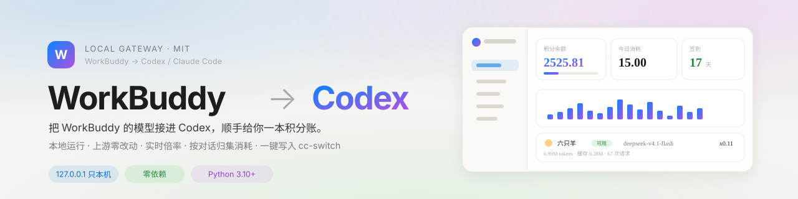
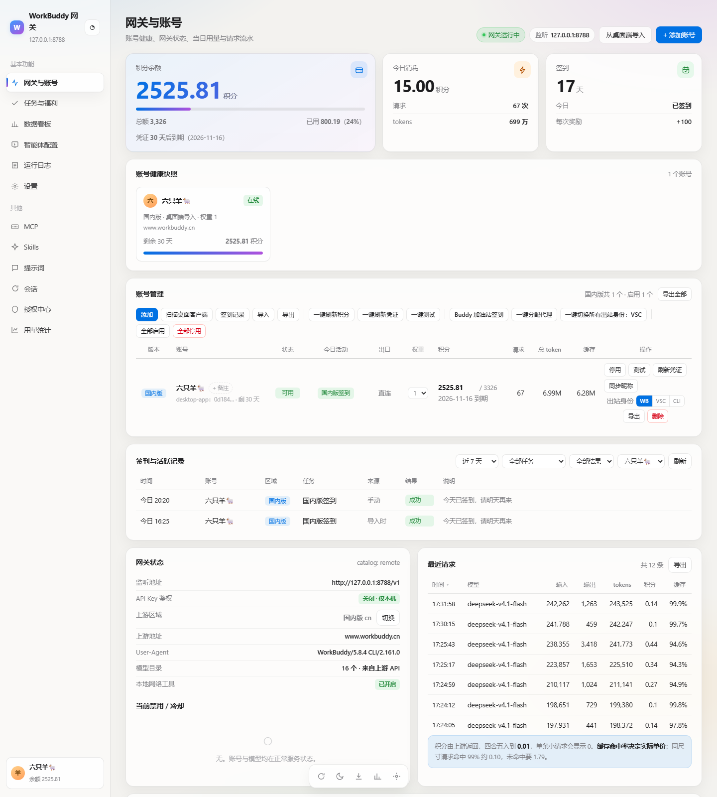
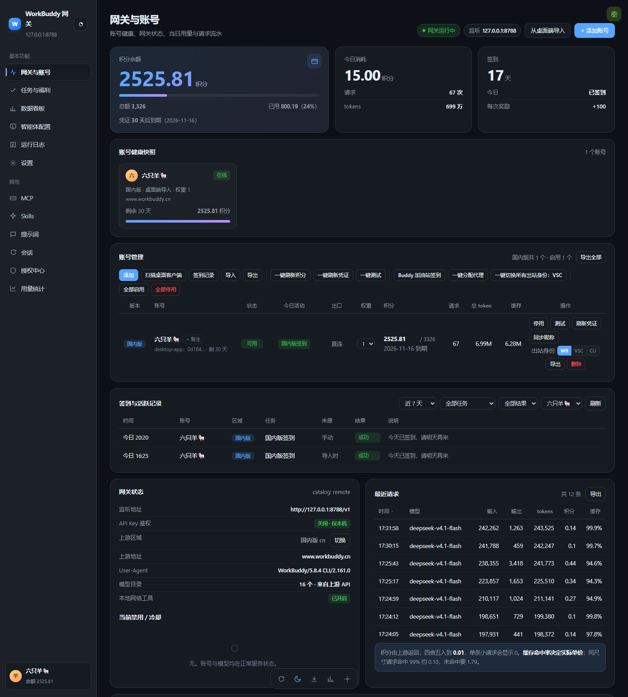
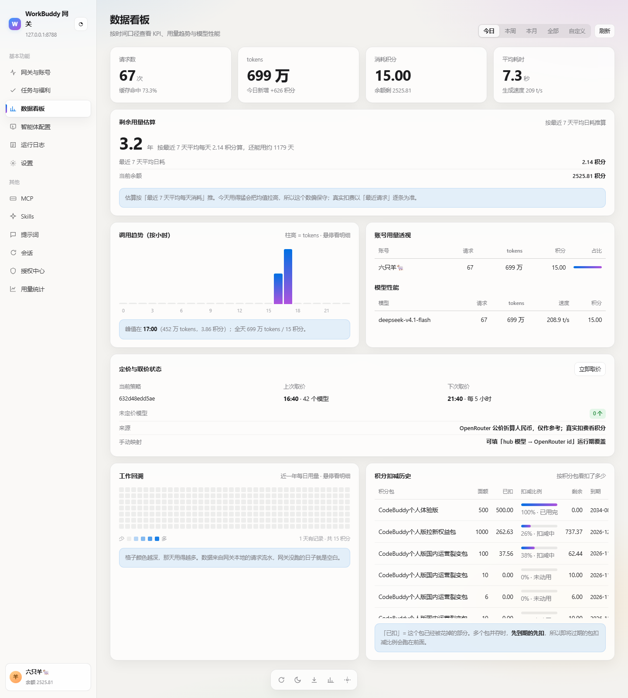
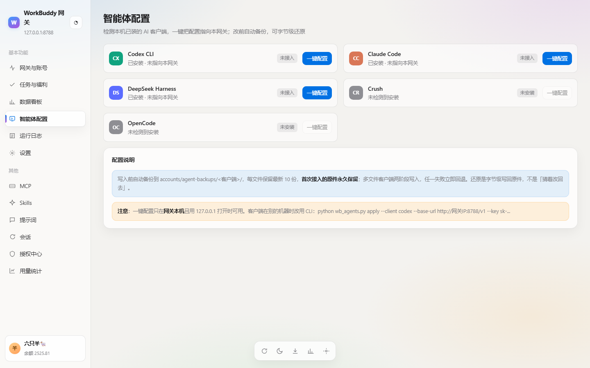
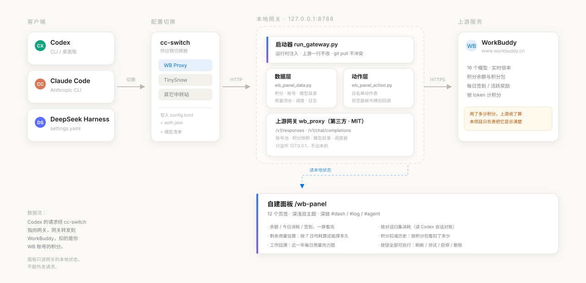

<div align="center">



# workbuddy2codex

**把 WorkBuddy 的模型接进 Codex / Claude Code，顺手给你一本精确到「每一次对话」的积分账。**

[](LICENSE)
[](https://www.python.org/)
[](#)
[](#)
[](#)

[快速开始](#快速开始) · [截图](#截图) · [面板](#面板) · [工作原理](#工作原理) · [常见问题](#常见问题)

</div>

---

## 这是什么

WorkBuddy（腾讯的 AI 编程助手）自带一整套模型，按**积分**计费。Codex 只认 OpenAI 兼容接口。

这个项目在中间架一层：

- **本地网关**：把 WorkBuddy 的模型转成 `responses` / `chat/completions`，Codex 直接能用
- **一个能用的面板**：12 个页签，余额、今日消耗、模型倍率、每次对话花了多少、积分包扣减明细，全在一屏
- **一键写入 cc-switch**：以后切供应商就是列表里点一下，跟别的中转站平级

数据全部来自网关本地状态。**不额外发请求、不上传任何东西、只监听 `127.0.0.1`。**

> 这不是另一个"多账号池管理器"。它解决的是三个具体问题：
> **① 我的积分花在哪了？② 这次对话花了多少？③ 怎么一键切过去？**

---

## 亮点

| | |
|---|---|
| **上游一行不改** | 面板、数据、写操作全部**运行时注入**。`gateway/` 是干净的第三方仓库，`git pull` 永远不会冲突 |
| **零第三方依赖** | 纯 Python 标准库。没有 pip install，没有 node_modules，克隆下来就能跑 |
| **积分精确到对话** | 不是估的。读 Codex 自己的会话记录（`token_usage_jsonl`）和网关流水对账，`token 数相等 + 时间最近` 精确配对 |
| **倍率实时同步** | 从上游目录拉，`deepseek-v4.1-flash = x0.11` 这种值不会过期 |
| **按钮真的能按** | 刷新积分、测试账号、启停、改权重、切出站身份、导入导出、删除账号 —— 全部打到网关自己的接口，走同一套校验 |
| **深浅双主题** | 浅色「极光」（暖白 + 毛玻璃 + 蓝紫渐变），深色「石墨」（GitHub Dark）。选择会记住 |
| **三个新视角** | 剩余用量估算（还能撑几天）、工作回溯（近一年热力图）、积分扣减历史（按积分包看扣了多少） |

---

## 截图

**浅色 · 网关与账号** —— 余额、今日消耗、签到，一屏看完；下面是账号健康快照和完整账号表



**深色 · 同一页** —— 深色是单独调的一套配色，不是把浅色反过来



**数据看板** —— KPI、剩余用量估算、按小时趋势、账号用量透视、模型性能、工作回溯、积分扣减历史



**智能体配置** —— 真实检测本机装了哪些客户端、有没有指向本网关



---

## 快速开始

### 前置

- Python 3.10+
- 一个 WorkBuddy 账号（桌面客户端已登录，或能走浏览器 OAuth）
- 想用 Codex / Claude Code 的话，装好对应客户端

### 三步

```bash
# 1. 克隆本项目
git clone https://github.com/study-yang/workbuddy2codex.git
cd workbuddy2codex

# 2. 克隆上游网关（本项目不改它任何一行，所以不放进仓库）
git clone https://github.com/ardeyouxipianyi/workbuddy2api-hub.git gateway

# 3. 起网关（Windows 直接双击 start-gateway.bat 也行）
python run_gateway.py --host 127.0.0.1 --port 8788
```

启动后面板自动打开：**http://127.0.0.1:8788/wb-panel**

第一次进去是空的，去「授权中心 → 扫描桌面客户端」把账号导进来（需要 WorkBuddy 客户端正在运行且已登录）。

### 接进 cc-switch（推荐）

```bash
python wb2cc.py           # 先预览：要写哪些行、模型清单长什么样
python wb2cc.py --write   # 确认无误再写（cc-switch 必须先完全退出）
```

之后在 cc-switch 里选中 **WB Proxy** 就能用。网关没开时切回原来的供应商即可，不会坏配置。

> **不想用 cc-switch？** 手动在 `~/.codex/config.toml` 加一段也行，见 [手动配置](#手动配置)。

### 接进 Claude Code

面板「智能体配置」页点 **一键配置**。它会把 `ANTHROPIC_BASE_URL` 指向本网关，原文件自动备份。

---

## 面板

打开 `http://127.0.0.1:8788/wb-panel`。

**12 个页签**：网关与账号 / 任务与福利 / 数据看板 / 智能体配置 / 运行日志 / 设置 / MCP / Skills / 提示词 / 会话 / 授权中心 / 用量统计。

**深链**：地址后面加页签名直接跳转

| 链接 | 打开 |
|---|---|
| `#dash` | 数据看板 |
| `#log` | 运行日志 |
| `#agent` | 智能体配置 |
| `?theme=dark` | 强制深色（配合深链用） |

**三个别处没有的区块**

<details>
<summary><b>剩余用量估算</b> —— 按最近 7 天平均日耗算余额还能撑多久</summary>

余额 2525 积分，日均消耗 2.14，显示「3.2 年」。

今天用得猛会把均值拉高，所以这个数偏保守。真实扣费永远以「最近请求」逐条为准 —— 那个数字是上游返回的原始值，不是算出来的。
</details>

<details>
<summary><b>工作回溯</b> —— 近一年每日用量热力图</summary>

按周成列的方块，颜色越深那天用得越多。悬停看当天 tokens 和积分。

数据来自网关本地的请求流水，网关没跑的日子就是空白。刚装好只有一列，用久了才好看。
</details>

<details>
<summary><b>积分扣减历史</b> —— 按「积分包」维度看扣了多少</summary>

WorkBuddy 的积分是一包一包发的（签到奖、裂变包、活动包），各自有到期时间，扣的时候**先到期的先扣**。

这张表告诉你：哪个包被花掉了、花了百分之多少、什么时候到期。金额对不上时，先看这里。
</details>

---

## 工作原理



三层，都在本机：

```
Codex ──► cc-switch ──► 本地网关 127.0.0.1:8788 ──► WorkBuddy 上游
                              ▲
                              │ 读本地状态 / 调自己的接口
                        自建面板（浏览器）
```

**为什么上游一行不改**

直接改第三方网关，`git pull` 就会冲突。所以本项目用**运行时注入**：

```python
import wb_proxy                    # 当模块导入，不触发它自己的 main
wb_proxy.DASHBOARD_HTML = 副本      # 面板副本，原文件不动
wb_proxy.Handler.do_GET = 包装过的方法   # 加几个只读路由
wb_proxy.main()                    # 再正常启动
```

面板的数据和按钮也走同一套思路：

- `wb_panel_data.py` 调网关的**模块级函数**（`account_views` / `credit_grants` / `fetch_models` / `get_logs` …），不发二次 HTTP
- `wb_panel_action.py` 现签一个面板令牌，回调网关**自己的** POST 接口 —— 校验、日志、错误处理全部复用，上游改实现这边自动跟

**代价**：升级上游后如果内部函数改名，本项目要跟着改。`git pull` 本身不会冲突。

---

## 文件清单

| 文件 | 作用 |
|---|---|
| `run_gateway.py` | 启动器。注入面板路由，挂 `/wb-panel`、`/wb-panel/data`、`/wb-panel/action` |
| `wb_panel_data.py` | 面板数据层。把网关内部状态拼成面板要的 JSON，8 秒缓存 |
| `wb_panel_action.py` | 面板动作层。白名单动作表，现签令牌回调网关接口 |
| `wb-panel.html` | 面板本体。单文件，12 页签，双主题 |
| `panel_sessions.js` | 原看板右下角的「对话积分」浮窗（可选） |
| `wb_sessions.py` | 按对话归集积分（命令行版，读 Codex 会话对账） |
| `wb2cc.py` | 写入 cc-switch：供应商 + 模型清单 + 余额查询脚本 |
| `open_panel.py` | 等端口通了再开浏览器，避免抢跑 |
| `start-gateway.bat` | Windows 一键启动 |
| `gateway/` | **第三方**（MIT），不进仓库，自行克隆 |

---

## 常见问题

<details>
<summary><b>倍率显示 <code>x0.00</code>，或者某个模型不见了</b></summary>

网关默认按**国际版**服务，国区账号必须切到 `cn`。启动脚本里已经写死 `WB_PROXY_DEFAULT_REALM=cn`，正常不会错。

如果确实错了：去原看板右上角确认区域是不是「国内版」。

另外，**拿不到有效倍率的模型会被静默隐藏** —— 上游有、面板没有，第一反应先查倍率。
</details>

<details>
<summary><b>面板显示「离线预览」，数字是示例值</b></summary>

网关没起。双击 `start-gateway.bat`，或者手动 `python run_gateway.py`。

面板设计成断网也能看（用内置示例数据兜底），方便调样式。
</details>

<details>
<summary><b>Codex 报连不上 <code>127.0.0.1:8788</code></b></summary>

按顺序检查：

1. 黑窗口还开着吗？
2. 代理软件是不是切到 **TUN 模式**了？TUN 会接管 `127.0.0.1`，把代理白名单加回来
3. `curl http://127.0.0.1:8788/health` 有没有返回

网关挂了不会坏数据 —— 切回原来的供应商就行，没有中间态。
</details>

<details>
<summary><b>改了 <code>wb-panel.html</code> 但页面没变</b></summary>

页面由网关每次请求重读，**刷新浏览器**即可，不用重启网关。
</details>

<details>
<summary><b>cc-switch 左下角一直显示 0%</b></summary>

cc-switch 靠每个供应商自己的「余额查询脚本」去问余额，没有脚本的供应商永远显示 0%。

```bash
python wb2cc.py --fix-balance     # cc-switch 要先完全退出
```

重启 cc-switch 后就是真实积分余额。
</details>

<details>
<summary><b>一键测试 / 刷新积分会不会花积分？</b></summary>

**会**。「一键测试」给每个账号真发一条最小请求；「刷新积分」逐个向上游查余额。量很小，但不是零。

「删除账号」不可撤销，但只删网关里的记录（含凭据文件），**WorkBuddy 账号本身不受影响**，重新导入即可恢复。
</details>

<details>
<summary><b>安全上要注意什么</b></summary>

- 网关只监听 `127.0.0.1`，所有面板接口都做本机回环校验
- `gateway/accounts/` 里是**明文 token**，别外传、别进同步盘、别进备份
- 导出的 JSON 含凭据，当密码看待
- 面板密码默认 `admin`。只自己用、不出局域网风险可控；要开 `--lan` 先改密码
</details>

---

## 手动配置

不用 cc-switch 的话，在 `~/.codex/config.toml` 加：

```toml
model_provider = "wb-proxy"
model = "deepseek-v4.1-flash"

[model_providers.wb-proxy]
name = "WB Proxy"
base_url = "http://127.0.0.1:8788/v1"
wire_api = "responses"        # 必须 responses，chat 会直接报错
env_key = "OPENAI_API_KEY"
```

然后 `~/.codex/auth.json` 里加 `{"OPENAI_API_KEY": "sk-wb-local"}`。

---

## 致谢

这个项目站在别人肩膀上：

- **[workbuddy2api-hub](https://github.com/ardeyouxipianyi/workbuddy2api-hub)** —— 网关本体（MIT）。账号池、`responses ↔ chat` 翻译、积分快照、模型目录、调度器，全是它做的。本项目只是给它加了一层壳
- **[cc-switch](https://github.com/farion1231/cc-switch)** —— 供应商切换器（MIT）。本项目负责把配置写进它的库
- 面板的设计参考了 [**ithtelab/workbuddy-manager**](https://github.com/ithtelab/workbuddy-manager) 的账号健康卡思路

`gateway/` 目录的全部代码版权归原作者，遵循其 MIT 许可。

---

## License

[MIT](LICENSE) © 2026 Zhiyang Liu
